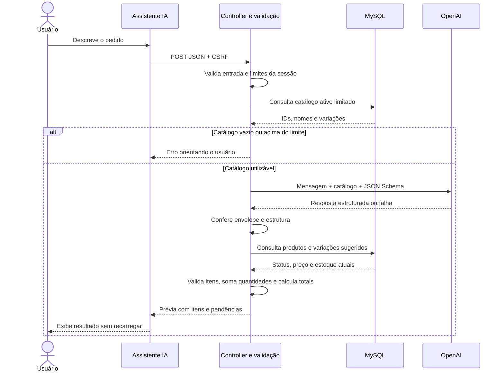

# Etapa 03 — Integração com Inteligência Artificial

> Atualização de 31/10/2026: este documento preserva o histórico da entrega original com OpenAI. A implementação atual usa Google Gemini, com configuração, protocolo e testes próprios. Consulte [Testes da IA com Gemini](TESTES-GEMINI.md) para o estado atual e o teste real optativo.

## O que desenvolvi

Nesta etapa, implementei o Assistente IA para converter mensagens comerciais em uma prévia de itens. Preservei a arquitetura MVC, o catálogo da Etapa 02, o layout administrativo e a regra de estoque por variação.

Meu objetivo foi usar a IA para interpretar linguagem natural e manter as regras comerciais no sistema. A IA sugere produtos, variações e quantidades; o PHP consulta o MySQL, verifica os dados e calcula os valores. A funcionalidade termina na prévia. Não avancei para a Etapa 04 nem criei pedidos, clientes, pagamentos, autenticação ou baixa de estoque.

## Como organizei as responsabilidades

| Componente | Responsabilidade que defini |
| --- | --- |
| `AIController` | Receber HTTP, validar CSRF e entrada, aplicar limites, coordenar consultas e devolver JSON |
| `AIRequestGuard` | Limitar mensagem, frequência e repetição por sessão |
| `Product::aiCatalog()` | Consultar catálogo ativo com contexto mínimo e limites explícitos |
| `AIService` | Preparar a chamada à OpenAI, executar cURL e tratar o envelope da Responses API |
| `AIResponseValidator` | Definir o JSON Schema e conferir a estrutura recebida no PHP |
| `OrderPreviewValidator` | Validar correspondências, consultar dados atuais, somar quantidades e calcular a prévia |
| `AIException` | Transportar código de erro, mensagem pública e status HTTP sem detalhes internos |
| `app/Views/ai/index.php` | Apresentar o formulário e a estrutura do resultado |
| `assistant.js` | Enviar com Fetch e renderizar a prévia usando texto seguro |

Reutilizei `Database`, `Product::find()`, `Session`, `View`, `Router` e os componentes Bootstrap existentes. Não adicionei um SDK PHP: cURL foi suficiente para uma única integração. Não precisei de migration nesta etapa porque todas as consultas usam o catálogo existente.

## Fluxo dos dados



Não abro uma transação durante a chamada externa: não há gravação, e a API pode demorar. Consulto os produtos novamente depois da interpretação e reutilizo a leitura de cada ID dentro da mesma prévia. Essa leitura não reserva estoque nem representa um snapshot transacional de todo o catálogo. Uma confirmação futura precisará revalidar disponibilidade e valores.

## Contrato com a OpenAI

Usei `POST https://api.openai.com/v1/responses`. Configurei o modelo com `OPENAI_MODEL` e a chave com `OPENAI_API_KEY`. Na requisição, defini `text.format` como `json_schema`, com `strict: true` e `additionalProperties: false` em todos os objetos. Todos os campos são obrigatórios no contrato; dados ausentes usam `null` quando permitido. Baseei esse formato na [documentação oficial de Structured Outputs](https://developers.openai.com/api/docs/guides/structured-outputs?api-mode=responses).

O esquema extrai:

- Por item: `product_id`, `product_name`, `quantity`, `variant_id`, `variant_name`, `color`, `size`, `characteristics` e `issues`.
- No pedido: `notes` e `requested_deadline`.

Preservo em `product_name` e `variant_name` o que o cliente mencionou, para comparar com o cadastro em vez de aceitar somente os IDs sugeridos. Não incluí preço, subtotal ou disponibilidade no esquema da IA. Essas informações vêm do banco.

Coloquei as regras internas em `instructions` e enviei mensagem e catálogo como dados JSON no conteúdo do usuário. Orientei o modelo a interpretar português brasileiro, reconhecer números por extenso, manter dados ausentes como `null` e não seguir comandos inseridos no texto ou nos nomes do catálogo. Não concedi ferramentas de escrita ao modelo.

As instruções ajudam a reduzir desvios, mas não garantem resistência completa a prompt injection nem interpretação correta. A proteção estrutural também depende do PHP: a resposta não aciona escrita no banco e não define os preços.

No envelope da API, procuro conteúdo `output_text` dentro das mensagens de `output`, sem assumir que a primeira saída é o texto final. Rejeito respostas incompletas, recusas, ausência de texto e dados incompatíveis. Uso um validador próprio restrito aos tipos e regras do esquema desta funcionalidade, não um validador genérico de todo o padrão JSON Schema.

## Regras comerciais que mantive no PHP

Para aceitar um item, verifico se o produto estava no catálogo enviado e continua existente e ativo. Comparo o nome extraído com o catálogo. Se vários produtos correspondem ao nome genérico, marco ambiguidade, mesmo que a IA tenha escolhido um ID.

Para produtos com variações, verifico a descrição solicitada, os atributos e o ID vinculado ao produto. Não escolho uma variação sem descrição, mesmo quando só existe uma. Quando a descrição corresponde a mais de uma variação, peço esclarecimento. Características que não consigo comprovar pelo nome da variação ficam pendentes; nesta versão não interpreto descrições extensas do cadastro.

Minha comparação é conservadora e usa tokens normalizados: caixa, acentos comuns, plurais simples e algumas equivalências de cores, como preta/preto. Isso evita aceitar IDs incompatíveis com o texto extraído, mas pode pedir confirmação em situações que uma pessoa entenderia. Também não comprova que toda extração da IA corresponde fielmente à mensagem original; por isso mantenho a conferência humana.

Aplico a regra de estoque da Etapa 02: produto simples usa `products.stock`; produto com variações usa o estoque da variação selecionada. Não somo o estoque simples com o estoque das variações.

Agrupo a demanda pela identidade de estoque: ID do produto simples ou ID da variação. Se duas linhas pedem três unidades da mesma variação e só existem cinco, ambas ficam com estoque insuficiente. Não aprovo a primeira linha arbitrariamente. Quantidades conhecidas de itens com correspondência de estoque também entram na soma quando existe outra pendência na interpretação.

Trabalho com preços decimais do banco e converto para centavos inteiros antes de multiplicar e somar. Com os limites desta versão e PHP de 64 bits, preservo a precisão sem usar `float`. Retorno valores como strings decimais, por exemplo `"119.70"`, e formato a moeda como texto também no JavaScript.

| Status | Como trato |
| --- | --- |
| `matched` | Item sem pendências na validação técnica |
| `ambiguous` | Mais de uma correspondência ou sugestão que não consigo confirmar |
| `not_found` | Produto ausente/inativo, variação inexistente ou atributo não confirmado |
| `insufficient_stock` | Quantidade acumulada acima do estoque |
| `missing_information` | Quantidade inválida/ausente ou variação não especificada |

Cada item contém `issues` e `statuses`, preservando problemas simultâneos. O campo `status` resume a primeira pendência; `ready` só é verdadeiro quando não há nenhuma. Esse campo indica que a prévia passou nas verificações técnicas, não que o pedido foi confirmado pelo cliente.

Calculo `subtotal` somente para itens sem pendências. `estimated_total` soma esses subtotais. Se houver qualquer problema, `has_pending_items` fica verdadeiro e a interface identifica o valor como **total parcial estimado dos itens sem pendências**.

## Endpoint e erros

Expus `GET /assistente` para a tela e `POST /api/ai/interpret` para interpretar. O corpo de entrada é:

```json
{"message":"Quero 3 camisetas pretas M para sexta-feira."}
```

O POST exige `Content-Type: application/json`, cookie da sessão e token no cabeçalho `X-CSRF-Token`. As URLs respeitam o subdiretório configurado. Na resposta de sucesso, envio `success`, `items`, `warnings`, `notes`, `requested_deadline`, `estimated_total`, `has_pending_items` e `preview_only`. Nos erros tratados pelo controller, mantenho as coleções vazias e `estimated_total: null`, além de `error.code` e `error.message`.

| HTTP | Situação |
| --- | --- |
| 200 | Interpretação processada, inclusive quando há itens pendentes |
| 400 | JSON de entrada inválido |
| 403 | CSRF inválido ou sessão expirada |
| 405 | Método não permitido pelo roteador |
| 413 | Corpo de entrada acima de 16.000 bytes |
| 415 | Content-Type incompatível |
| 422 | Mensagem inválida, catálogo vazio/excedido ou recusa do modelo |
| 429 | Limite local por sessão ou repetição em intervalo curto |
| 500 | Falha interna, incluindo indisponibilidade do banco |
| 502 | Falha de conexão, resposta inválida/incompleta ou erro externo não classificado |
| 503 | Chave/modelo/cURL ausente, configuração rejeitada, limite ou indisponibilidade do provedor |
| 504 | Timeout da chamada externa |

Mantive o comportamento existente do roteador: erros de método e de rota são páginas HTML; os erros dentro do endpoint POST são JSON. O JavaScript também trata uma resposta que não seja JSON.

## Limites que adotei

| Limite | Valor |
| --- | --- |
| Mensagem | 1 a 2.000 caracteres após remover espaços externos |
| Corpo HTTP | Até 16.000 bytes |
| Frequência | Cinco tentativas por sessão em uma janela móvel de 60 segundos |
| Duplicação | Mesma mensagem bloqueada por 15 segundos |
| Catálogo | Até 100 produtos e 500 linhas do JOIN produto/variação |
| Contexto serializado | Até 64.000 bytes, incluindo a mensagem |
| Itens retornados | Até 50 |
| Quantidade por item | Inteiro entre 1 e 10.000 |
| Saída solicitada | Até 4.000 tokens; um pedido grande ainda pode exceder esse orçamento |
| Conexão / chamada externa | 5 / 30 segundos |
| Corpo de resposta externa | Até 1 MiB |
| Espera do navegador | Até 45 segundos |

Uma linha do JOIN representa uma variação ou um produto sem variações. Consulto uma linha extra para detectar excesso e rejeito o catálogo inteiro, em vez de omitir produtos silenciosamente. Essa abordagem atende ao catálogo pequeno do MVP; não implementei embeddings nem busca vetorial.

Armazeno na sessão apenas hashes e horários para controlar frequência, sem histórico das mensagens. Mantenho o lock da sessão durante o processamento para serializar chamadas concorrentes; isso simplifica o MVP, mas pode atrasar outra requisição da mesma sessão. Tentativas que chegam ao controle de frequência contam mesmo se depois o catálogo ou a API falhar.

No navegador, desabilito o botão durante a chamada, mostro carregamento e escondo a prévia anterior quando o texto muda. Renderizo os dados com `textContent`, evitando interpretar HTML vindo da IA. Não faço repetição automática de chamadas.

Como o projeto ainda não tem autenticação, o limite por sessão não protege contra alguém que crie sessões novas. Não considero o endpoint pronto para exposição pública sem controles adicionais de acesso e consumo. Os limites de tamanho reduzem o uso acidental, mas não garantem um orçamento financeiro. Também não trato `store: false` como garantia de retenção zero pelo provedor.

## Como configurei a integração

1. Mantive as configurações existentes de aplicação e MySQL no `.env`.
2. Adicionei `OPENAI_API_KEY` e `OPENAI_MODEL`, conforme o exemplo do README.
3. Verifiquei a extensão cURL e o suporte HTTPS do PHP. Não desativei a verificação de certificados.
4. Mantive as credenciais fora dos arquivos públicos e do versionamento.
5. Disponibilizei o formulário mesmo sem chave; a integração informa configuração ausente quando uma interpretação exige a API.

Não registrei mensagens completas, credenciais nem respostas brutas do provedor nos logs. Os exemplos da documentação usam somente valores fictícios.

## Como testei e o que os resultados demonstram

Executei os testes sem consumir créditos da OpenAI. Usei um transporte substituível por `Closure` no `AIService` para simular respostas e falhas; essa substituição existe somente no código PHP, sem flag HTTP para ativar uma API falsa.

| Verificação executada | Resultado |
| --- | --- |
| `tests/run.php` | 73 verificações gerais aprovadas |
| `tests/ai.php` | 77 verificações de IA aprovadas, sem rede ou banco |
| `tests/products_mysql.php` | 19 verificações de produtos aprovadas em banco isolado |
| `tests/ai_mysql.php` | 10 verificações de IA/MySQL aprovadas em banco isolado |
| `tests/ai_browser.cjs` | 23 verificações por execução, com respostas de sucesso simuladas |
| `composer validate --strict` | Manifesto válido |
| Sintaxe PHP | Arquivos PHP verificados sem erros |

Os testes cobrem produto válido, múltiplos itens, variações, produto inexistente/inativo, IDs incompatíveis, variação ausente, estoque insuficiente, itens repetidos, quantidade inválida, mensagem vazia/longa, ausência de chave/modelo, falhas simuladas de conexão/timeout, recusa, JSON inválido, resposta incompleta e limites do catálogo.

No teste de prompt injection, verifico que a mensagem maliciosa permanece nos dados do usuário e não é incorporada às instruções internas. Isso não é uma avaliação real da resistência do modelo. Da mesma forma, a resposta simulada para “duas camisetas” comprova que o PHP processa a quantidade 2, mas não mede a capacidade linguística da OpenAI.

Nos testes MySQL, crio e removo apenas um banco aleatório com prefixo `ai_order_test_`. Comparo os registros antes e depois da interpretação para confirmar que produtos, variações e estoque não mudam. Não importo dados no catálogo do usuário.

No Edge, verifico as respostas HTTP reais de validação, o token no Fetch, o carregamento, o bloqueio de duplicação, mensagens de erro, o total parcial, a renderização de texto potencialmente malicioso e o foco no resultado. Também verifico a ausência de transbordamento da página em 320 e 390 px; a tabela pode rolar dentro do painel.

O ambiente utilizado foi PHP 8.2.12 e MariaDB 10.4.32. Não executei MySQL 8 nem uma chamada real à OpenAI nesta entrega. A configuração de uma conta real, a aceitação do esquema pelo modelo escolhido, a conectividade TLS até o provedor, a latência e a qualidade do reconhecimento continuam dependendo de uma verificação real.

### Como reproduzir

```powershell
C:\xampp\php\php.exe .tools\composer.phar validate --strict
C:\xampp\php\php.exe tests\run.php
C:\xampp\php\php.exe tests\ai.php
C:\xampp\php\php.exe tests\products_mysql.php
C:\xampp\php\php.exe tests\ai_mysql.php
```

Se Composer estiver no PATH, `composer test` executa as duas suítes sem banco. As suítes MySQL exigem credenciais locais com permissão para criar/remover bancos de teste.

O teste opcional de navegador usa Node.js, Playwright disponível na raiz ou em `.qa` e Microsoft Edge instalado. A aplicação não depende dessas ferramentas. Com o servidor local iniciado:

```powershell
node tests\ai_browser.cjs
```

Para verificar Apache com subdiretório, uso outro terminal ou ajusto somente a variável de teste:

```powershell
$env:AI_ORDER_TEST_URL = 'http://localhost/ai-order/public'
node tests\ai_browser.cjs
Remove-Item Env:AI_ORDER_TEST_URL
```

### Verificação manual com a API real

Depois de configurar uma chave e um modelo acessível na conta, abro o Assistente IA e uso os exemplos do README com os produtos correspondentes cadastrados. Confiro produto, quantidade, variação, prazo, preço e alertas. Também testo nomes ambíguos, quantidade vaga e duas linhas cuja soma exceda o estoque. Cada tentativa real pode gerar cobrança.

Antes e depois da interpretação, comparo o estoque no catálogo. Não espero nenhum pedido salvo. Se faltar chave/modelo, espero uma mensagem de configuração; com catálogo vazio, espero orientação para cadastrar produtos antes de qualquer chamada à OpenAI.

## Arquivos desta etapa

Criei:

- `app/Controllers/AIController.php`.
- `app/Services/AIService.php`, `AIException.php` e `AIRequestGuard.php`.
- `app/Validation/AIResponseValidator.php` e `OrderPreviewValidator.php`.
- `app/Views/ai/index.php` e `public/assets/js/assistant.js`.
- `config/ai.php`.
- `tests/ai.php`, `tests/ai_mysql.php` e `tests/ai_browser.cjs`.
- `docs/ETAPA-03.md`.

Modifiquei:

- `app/Models/Product.php`: consulta limitada do catálogo ativo.
- `routes/web.php`: tela e endpoint de interpretação.
- `app/Views/layouts/app.php`: script do assistente e identificação da versão.
- `app/Views/dashboard/index.php`: indicação da Etapa 03 disponível.
- `public/assets/css/app.css`: painel e tabela da prévia.
- `.env.example`: variáveis OpenAI.
- `composer.json`: inclusão dos testes de IA no comando de testes.
- `README.md`: configuração, fluxo, exemplos, limites e resultados.

Mensagem de commit sugerida:

```text
feat(ai): add structured order interpretation and validated previews
```

## Meu roteiro para revisão técnica

**Como explico a funcionalidade?** Desenvolvi uma integração que recebe um pedido em linguagem natural e o transforma em uma prévia. A IA extrai os dados; o PHP consulta o catálogo e aplica as regras comerciais. O usuário precisa conferir o resultado.

**Por que usei Structured Outputs?** Quis um contrato explícito para reduzir variações de formato. Ainda valido a estrutura no PHP e separo isso da validação de negócio: um JSON válido pode conter um produto errado ou uma quantidade incompatível.

**Por que não confio no preço da IA?** O preço comercial pertence ao catálogo. Busco esse valor no banco, faço os cálculos em centavos inteiros e não incluo preço no esquema enviado ao modelo.

**Como evitei aprovar itens repetidos acima do estoque?** Agrupei as quantidades pelo produto simples ou pela variação. Comparei o total solicitado com o estoque dessa identidade e marquei todas as linhas envolvidas quando a soma excede o disponível.

**Como preservei a arquitetura?** Acrescentei um controller, um serviço de integração e validadores. Reutilizei o roteador, a sessão, o Model e o layout. Mantive chamadas externas fora da apresentação.

**Como tratei falhas?** Diferenciei erros de entrada, configuração, limite, conexão, timeout, recusa e resposta incompatível. Retornei mensagens públicas sem detalhes internos e deixei novas tentativas sob controle do usuário.

**Como testei sem gastar créditos?** Substituí o transporte HTTP por respostas controladas e testei a validação separadamente. Também combinei esse transporte simulado com consultas reais em um banco temporário. Não apresento esses testes como prova de qualidade do modelo real.

**Qual é a principal limitação?** O modelo pode interpretar errado, e a comparação local é conservadora. O resultado é uma prévia sujeita à conferência. Além disso, estoque e preço podem mudar depois da consulta.

**O que falta antes de usar publicamente?** Autenticação e controles de acesso/consumo mais fortes. O limite por sessão e o CSRF atendem ao MVP local, mas não impedem abuso com novas sessões.

**Como eu evoluiria a confirmação?** Em uma etapa autorizada, revalidaria os itens e o estoque no momento da gravação, usando transação e controle de concorrência. Não anteciparia essa gravação dentro da interpretação de IA.
